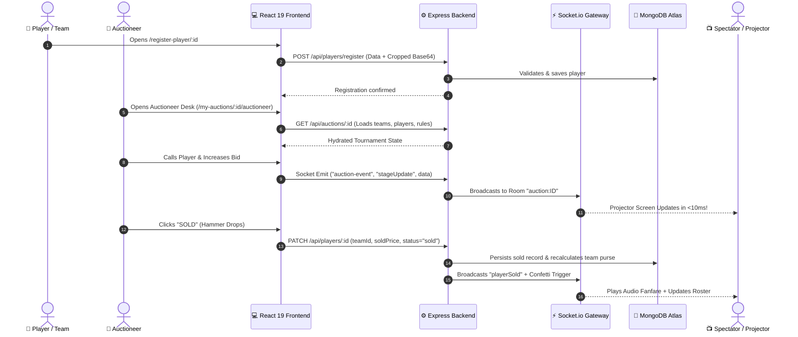

# 🏆 AOTMS PLAYERS AUCTION — Real-Time Sports Auction & League Management Platform

> **The Next-Generation Digital Auction & Tournament Roster System**  
> *Empowering Grassroots Tournaments, Corporate Leagues, and Professional Franchises with Sub-Second Live Bidding, Automated Purse Safeguards, Multi-Sport Engines, and Broadcast-Ready Visuals.*

---

## 📌 Quick Reference & Attribution
* **Platform Name:** **AOTMS PLAYERS AUCTION** (also known as *AOTMS Premier Sports Auction Platform* / *PitchBid*)
* **Founder & Visionary:** **Ameen Sayyed**
* **Official Contact / Support:** `+91 80199-52233`
* **Admin Portal:** `aotms@aotms.com`
* **Supported Sports:** **Cricket**, **Badminton**, **Football**, **Volleyball**, **Kabaddi**
* **Architecture:** Full-Stack Monorepo (Node.js Express REST API + Socket.io + MongoDB Atlas + React 19 + TanStack Router/Query + TailwindCSS + Three.js)

---

## 📑 Table of Contents
1. [Executive Summary](#-executive-summary)
2. [Problem Statement & The AOTMS Solution](#-problem-statement--the-aotms-solution)
3. [Multi-Sport Engine Architecture](#-multi-sport-engine-architecture)
4. [Core Features & Modules](#-core-features--modules)
   - [1. Public Landing & Discovery Arena](#1-public-landing--discovery-arena)
   - [2. Self-Service Public Registration Portals](#2-self-service-public-registration-portals)
   - [3. Tournament Management Dashboard](#3-tournament-management-dashboard)
   - [4. Auctioneer Master Console (Trial vs Live)](#4-auctioneer-master-console-trial-vs-live)
   - [5. Spectator & Projector Broadcast Arena](#5-spectator--projector-broadcast-arena)
   - [6. Dynamic Purse & Max-Bid Safety Engine](#6-dynamic-purse--max-bid-safety-engine)
   - [7. Comprehensive PDF & Excel Export Suite](#7-comprehensive-pdf--excel-export-suite)
   - [8. Role-Based Access Control & Tournament Isolation](#8-role-based-access-control--tournament-isolation)
5. [System Architecture & Data Flow](#-system-architecture--data-flow)
6. [Technology Stack](#-technology-stack)
7. [Database Schema & Entity Models](#-database-schema--entity-models)
8. [API Endpoints & Real-Time WebSocket Events](#-api-endpoints--real-time-websocket-events)
9. [Installation & Deployment Guide](#-installation--deployment-guide)
10. [🎨 Ready-to-Use Material for Marketing Posters & Flyers](#-ready-to-use-material-for-marketing-posters--flyers)
11. [📄 Ready-to-Use Material for Project Reports & PDF Documents](#-ready-to-use-material-for-project-reports--pdf-documents)

---

## 🌟 Executive Summary

**AOTMS PLAYERS AUCTION** is a complete, enterprise-grade sports tournament auction and franchise management platform designed to replace chaotic manual bidding, error-prone spreadsheets, and fragmented WhatsApp communications. 

Whether organizing a high-stakes corporate cricket league, a state-level badminton championship, or a grassroots weekend turf cup, AOTMS delivers the thrill and precision of professional televised sports auctions (like the IPL, PKL, and ISL) directly to laptops, tablets, projectors, and mobile phones.

Built from the ground up for zero latency, AOTMS connects auctioneers, team owners, players, and spectators in real time. The platform features an intelligent financial safeguard that automatically prevents teams from overspending, automated lot shufflers, instant unsold rounds, audio-visual hammer effects, digital player registration with payment proof verification, and one-click generation of branded PDF rosters and styled Excel spreadsheets.

---

## 🎯 Problem Statement & The AOTMS Solution

| The Traditional Manual Way (Before AOTMS) | The Modern AOTMS Way |
| :--- | :--- |
| **Spreadsheet Chaos:** Organizers struggle with Excel formulas during live bidding; one formula typo crashes the purse calculations. | **Automated Financial Engine:** Live purse deductions, spent totals, and maximum safe bid calculations update instantly after every gavel strike. |
| **Overspending Disputes:** Teams accidentally bid more than they have, leaving them unable to complete their mandatory player count. | **Dynamic Max-Bid Safeguard:** Mathematical formula strictly locks bids so teams always reserve enough purse to buy remaining squad slots. |
| **Delayed & Confusing Communication:** Owners crowd the auctioneer table; spectators have no way to track bids or sold players in real time. | **Real-Time WebSocket Sync:** Sub-second live updates across mobile phones, laptops, and giant projector/TV broadcast screens. |
| **Manual Registration Headaches:** Collecting player details, photos, kit sizes, and UPI payment slips across WhatsApp chats and paper forms. | **Integrated Self-Service Portals:** Public QR code registration with in-browser photo cropping, sport-specific attributes, kit sizing, and UTR verification. |
| **Post-Auction Administrative Drain:** Spending hours typing up team squads, payment ledgers, and player rosters for sponsors and captains. | **Instant One-Click Export:** Generates professionally styled Excel workbooks and broadcast-quality PDF tournament certificates in seconds. |

---

## 🏅 Multi-Sport Engine Architecture

Unlike single-sport auction tools, AOTMS is engineered with a modular sport-attribute system supporting five major team sports:

```
                  ┌─────────────────────────────────────────┐
                  │          AOTMS Multi-Sport Core         │
                  └────────────────────┬────────────────────┘
          ┌──────────────┬─────────────┼─────────────┬──────────────┐
          ▼              ▼             ▼             ▼              ▼
     🏏 Cricket    🏸 Badminton   ⚽ Football   🏐 Volleyball   🤼 Kabaddi
     • Batsman      • Singles      • Striker     • Spiker        • Raider
     • Bowler       • Doubles      • Midfielder  • Blocker       • Left Corner
     • All-Rounder  • Both         • Defender    • Setter        • Right Corner
     • Bat/Bowl     • Dominated    • Goalkeeper  • Libero        • All-Rounder
       Styles         Hand         • Foot        • Jump Height   • Super Raids
```

### 1. 🏏 Cricket
* **Player Roles:** Batsman, Bowler, All-Rounder, Wicket-Keeper.
* **Specializations:** Batting Style (Right-Hand / Left-Hand), Bowling Style (Fast, Medium, Off-Spin, Leg-Spin).
* **Tracked Statistics:** Total Matches, Career Runs, Wickets Taken, Batting Strike Rate, Economy.

### 2. 🏸 Badminton
* **Player Roles:** Singles Player, Doubles Player, Both (Versatile).
* **Specializations:** Dominated Hand (Right / Left).
* **Tracked Statistics:** Matches Played, Wins, Win Percentage, Tournament Honors.
* **Apparel Specifications:** Jersey Name, Jersey Number, Jersey Size, Boxer/Short Waist Size (e.g., 28, 30, 32, 34).

### 3. ⚽ Football (Soccer)
* **Player Roles:** Goalkeeper, Center Back / Defender, Midfielder, Winger, Forward / Striker.
* **Specializations:** Preferred Foot (Left / Right / Both).
* **Tracked Statistics:** Matches Played, Goals Scored, Assists, Clean Sheets.

### 4. 🏐 Volleyball
* **Player Roles:** Attacker, Setter, Libero, Spiker, Blocker, Universal, Opposite Hitter, Middle Blocker.
* **Specializations:** Dominated Hand, Spike Reach Height, Block Jump Height.
* **Tracked Statistics:** Matches, Attack Points, Block Points, Serve Aces.

### 5. 🤼 Kabaddi
* **Player Roles:** Raider, Defender (Left Corner), Defender (Right Corner), Defender (Cover), All-Rounder.
* **Specializations:** Special Move (Dubki, Toe Touch, Ankle Hold, Thigh Hold).
* **Tracked Statistics:** Matches Played, Total Raid Points, Successful Tackle Points, Super Raids.

---

## 🚀 Core Features & Modules

### 1. Public Landing & Discovery Arena
* **3D Interactive Robot Hero:** A high-performance Three.js 3D model that reacts visually on the home showcase.
* **Live & Today's Auctions Carousel:** Instant display of all active auctions with "LIVE BIDDING" badges, countdown timers, and sport category tags.
* **Upcoming Tournament Schedule:** Complete calendar view allowing players and franchises to preview upcoming drafts.
* **Pricing & Tournament Tiers:** Transparent club, premier, and mega tournament packages.
* **Founder Spotlight:** Integrated attribution to Founder **Ameen Sayyed** with direct telephone access (+91 80199-52233).

### 2. Self-Service Public Registration Portals
* **Dedicated Registration URLs & QR Codes:** Shareable links (`/register-player/:auctionId` and `/register-team/:auctionId`) that organizers can print on posters or blast on social media.
* **Interactive Image Cropper:** Allows players to upload their profile photos and visually crop them into high-resolution circular cards directly in their browser.
* **Sport-Adaptive Form Fields:** Form inputs automatically morph based on the tournament sport (e.g., batting style for cricket, short size for badminton).
* **Complete Kit & Logistics Sizing:** Captures player jersey name, jersey number, jersey size (S, M, L, XL, XXL, 3XL), trouser/pant size, and boxer/short size.
* **Payment & UTR Verification:** Players select payment mode (UPI, Google Pay, PhonePe, Cash, Bank Transfer), enter the bank UTR transaction number, and upload their payment screenshot.
* **Anti-Duplicate Safety:** Automatic validation prevents duplicate phone numbers from registering twice in the same tournament.

### 3. Tournament Management Dashboard
* **Franchise / Team Management:** Create teams, upload high-res team logos, set franchise owners, phone numbers, and custom team color themes.
* **Player Pool Roster:** Searchable and filterable master grid showing all players categorized by status (*Pending*, *Sold*, *Unsold*), grade/tier, base price, and team.
* **Grade & Category Allocator:** Quick-edit dialog to assign players into competitive tiers (e.g., Marquee, Grade A, Grade B, Local, Icon).
* **Real-Time Auction Code:** Instant room code generation (e.g., `fe924b`) for fast joining on mobile devices.
* **Sponsor & MVP Showcase:** Dedicated tabs to display tournament sponsors, partner logos, and tournament MVP leaderboards.

### 4. Auctioneer Master Console (Trial vs Live)
* **Two Operating Modes:**
  * 🧪 **Trial Mode (Sandbox Rehearsal):** Run mock auctions, test bidding increments, and train franchise owners without modifying the database.
  * 🔴 **Live Mode (Official Real-Time Draft):** Every hammer drop commits permanent sold records, updates purses, and broadcasts live WebSocket socket events.
* **Lot Calling Options:**
  * 🎲 **Random Lot Shuffler:** Automatically calls random unsorted players with exciting presentation cards.
  * 🎯 **Manual Lot Picker:** Search and select any specific player by name, grade, or role.
* **Auctioneer Controls:**
  * 🔨 **Hammer / Sold Action:** Rings audio chimes, triggers confetti cannons, updates team purse, and moves to the next lot.
  * ❌ **Mark Unsold:** Instantly moves passed players to the unsold pool for later recall.
  * 🔄 **Single & Bulk Unsold Recall:** One-click re-introduction of all unsold players back into the bidding pool for Round 2.
  * ✏️ **Live Price & Team Overrides:** Correct accidental bids or reassign teams on the fly without refreshing.
  * 🔊 **Audio-Visual Effects:** Integrated gavel hammer audio, bidding increments, and full-screen sold banners.

### 5. Spectator & Projector Broadcast Arena
* **Audience Broadcast View (`/live/:auctionId`):** Optimized for venue projectors, LED stadium screens, and YouTube/Twitch live stream overlays.
* **Sub-Second Stage Sync:** Instant visual synchronization whenever the auctioneer calls a player, changes a bid, or closes a sale.
* **Ticker Tape Marquee:** Dynamic scrolling bottom banner with tournament branding, rules, and live updates.
* **Interactive Team Purse Cards:** Displays each franchise's remaining purse, players bought, players needed, and maximum allowable bid in real time.

### 6. Dynamic Purse & Max-Bid Safety Engine
To protect the integrity of the tournament, AOTMS implements a strict mathematical purse constraint:

$$\text{Max Allowable Bid} = \text{Remaining Purse} - \Big(\max(0, \text{Required Squad Size} - \text{Current Squad Size} - 1) \times \text{Minimum Base Bid}\Big)$$

* **Why this matters:** If a team has \$10,000 left and still needs to buy 3 more players (with a minimum bid of \$500), they can spend at most $\$10,000 - (2 \times \$500) = \$9,000$ on the current player. This mathematically guarantees they will never run out of funds to complete their mandatory squad!

### 7. Comprehensive PDF & Excel Export Suite
* **Custom Excel Exports (`.xlsx`):**
  * Auto-styled with tournament headers, custom row heights, and dark navy borders.
  * Exports **Complete Auction Workbook** with dedicated tabs for Teams, Squads, Sold Players, Unsold Players, and Financial Turnover.
  * Exports **Players Master List** and **Team Summary Sheet**.
* **Branded PDF Reports (`.pdf`):**
  * Generated client-side using `jspdf` and `jspdf-autotable`.
  * Formatted in clean A4 portrait layout with dark header banners, team breakdowns, sold prices, jersey numbers, and chapter/city details.

### 8. Role-Based Access Control & Tournament Isolation
* **👑 Super Administrator (`aotms@aotms.com`):** Global access to create, edit, monitor, and manage every tournament on the platform.
* **🏢 Isolated Franchise Desk Accounts:** Specialized accounts (such as `hunterz@gmail.com`, `panthersbleague@gmail.com`, `ufc@gmail.com`) locked exclusively to their specific tournament. They cannot view or tamper with any other tournament data.
* **👥 Public Users & Spectators:** Can view public live streams, check upcoming auctions, and register as players or teams without logging in.

---

## 🏗️ System Architecture & Data Flow



---

## 💻 Technology Stack

### Frontend (Client-Side)
* **Framework:** React 19 (Modern functional architecture with hooks)
* **Routing:** TanStack Router (Type-safe, file-based routing)
* **Data Fetching & Caching:** TanStack React Query v5 (Optimistic updates, prefetching, and automatic background invalidation)
* **Styling & Design System:** TailwindCSS v4 + Radix UI primitives
* **Animations & 3D Graphics:** Framer Motion + Three.js + React Three Fiber (`@react-three/drei`)
* **Real-Time Client:** Socket.io Client
* **Document Generation:** `xlsx`, `xlsx-js-style`, `jspdf`, `jspdf-autotable`
* **Icons & Notifications:** Lucide React + Sonner Toasts + Canvas Confetti
* **Build Tool:** Vite 8

### Backend (Server-Side)
* **Runtime:** Node.js (v18+)
* **Server Framework:** Express.js 4 (REST API endpoints with structured route separation)
* **Real-Time Engine:** Socket.io 4 (WebSocket room clustering for live draft synchronization)
* **Database ODM:** Mongoose 8 (Schema definitions, indexes, validation)
* **Authentication & Security:** JWT (JSON Web Tokens), bcryptjs password hashing, CORS whitelist protection
* **Media & Cloud Storage:** Cloudinary SDK (Automated base64 image optimization and CDN hosting)
* **In-Memory Caching:** Ultra-fast in-memory cache for high-frequency team and roster endpoints (<1ms responses)

### Database & Infrastructure
* **Primary Database:** MongoDB Atlas (Cloud NoSQL Database with compound indexes on `auctionId`, `status`, and `phone`)
* **Hosting Support:** Vercel (Frontend), Render / Railway / DigitalOcean / VPS (Backend)

---

## 📊 Database Schema & Entity Models

### 1. `Auction` Schema
Represents the tournament container and bidding rules.
```javascript
{
  sportType: { type: String, enum: ["cricket", "badminton", "football", "volleyball", "kabaddi"], required: true },
  name: { type: String, required: true, trim: true, maxlength: 120 },
  coverImage: { type: String },
  startsAt: { type: Date, required: true },
  playersPerTeam: { type: Number, required: true, min: 1 },
  pointsPerTeam: { type: Number, required: true, min: 1 },     // Total team purse (e.g. 100,000)
  minimumBid: { type: Number, required: true, default: 5000 }, // Base opening price
  maxBid: { type: Number, required: true, default: 300000 },   // Maximum single-bid ceiling
  bidIncrement: { type: Number, default: 500, min: 1 },        // Minimum price step
  visibility: { type: String, enum: ["public", "semi-private", "private"], default: "public" },
  status: { type: String, enum: ["draft", "live"], default: "draft" },
  createdBy: { type ObjectId, ref: "User", required: true },
  timestamps: true
}
```

### 2. `Team` Schema
Represents a participating franchise.
```javascript
{
  auctionId: { type: ObjectId, ref: "Auction", required: true, index: true },
  name: { type: String, required: true, trim: true },
  shortName: { type: String, required: true, trim: true }, // e.g., "MI", "CSK", "HNT"
  logo: { type: String, default: null },
  ownerName: { type: String, trim: true, default: "" },
  ownerPhone: { type: String, trim: true, default: "" },
  colorTheme: { type: String, trim: true, default: "" },   // Custom hex badge color
  timestamps: true
}
```

### 3. `Player` Schema
Represents an athlete registered in the auction pool.
```javascript
{
  auctionId: { type: ObjectId, ref: "Auction", required: true, index: true },
  teamId: { type: ObjectId, ref: "Team", default: null, index: true },
  name: { type: String, required: true, trim: true },
  phone: { type: String, required: true, trim: true },
  age: { type: Number, default: null },
  category: { type: String, default: "" },              // e.g. "Icon", "Grade A", "Marquee"
  baseValue: { type: Number, default: 0 },
  soldPrice: { type: Number, default: null },
  auctionRoundStatus: { type: String, enum: ["pending", "sold", "unsold"], default: "pending" },
  
  // Apparel & Kit Specs
  jerseySize: { type: String, default: "" },
  jerseyName: { type: String, default: "" },
  trouserSize: { type: String, default: "" },
  boxerSize: { type: String, default: "" },             // For Badminton/Indoor sports
  
  // Payment Verification
  paymentMode: { type: String, default: "" },           // "UPI", "Cash", etc.
  utrNumber: { type: String, default: "" },
  paymentImage: { type: String, default: null },
  
  // Dynamic Sport Attributes
  sportFields: { type: Map, of: Mixed, default: {} },   // Batting style, goals, smash reach, etc.
  photo: { type: String, default: null },
  timestamps: true
}
```

### 4. `User` Schema
Represents administrators and franchise managers.
```javascript
{
  email: { type: String, required: true, unique: true, lowercase: true },
  passwordHash: { type: String, required: true },
  name: { type: String, required: true },
  role: { type: String, enum: ["admin", "user"], default: "user" },
  bookmarkedAuctionIds: [{ type: ObjectId, ref: "Auction" }],
  timestamps: true
}
```

---

## ⚡ API Endpoints & Real-Time WebSocket Events

### REST Endpoints
| Method | Route | Description | Auth Required |
| :--- | :--- | :--- | :--- |
| `POST` | `/api/auth/sign-in` | Authenticate user & issue JWT | No |
| `GET` | `/api/auth/me` | Fetch active session & permissions | Yes |
| `GET` | `/api/auctions` | List tournaments (supports `?mine=true`, sport filters) | Optional |
| `POST` | `/api/auctions` | Create a new tournament | Admin |
| `GET` | `/api/auctions/:id` | Get single auction configuration & rules | Optional |
| `PATCH` | `/api/auctions/:id` | Update tournament settings / purse / dates | Organizer/Admin |
| `DELETE` | `/api/auctions/:id` | Remove tournament & cascade cleanups | Organizer/Admin |
| `GET` | `/api/auctions/:id/teams` | Get all franchises for an auction | Optional |
| `POST` | `/api/teams` | Create a new franchise | Organizer/Admin |
| `POST` | `/api/teams/register` | Public self-service team registration | No |
| `GET` | `/api/auctions/:id/players`| Get all players with status & prices | Optional |
| `POST` | `/api/players` | Add player from organizer dashboard | Organizer/Admin |
| `POST` | `/api/players/register` | Public self-service player registration | No |
| `PATCH` | `/api/players/:id` | Update player (sold price, team, grade) | Organizer/Admin |
| `POST` | `/api/auctions/:id/repeat-unsold` | Bulk recall all unsold players to pending | Organizer/Admin |

### WebSocket Real-Time Events (`Socket.io`)
* `join-auction (auctionId)`: Joins the isolated socket room for that specific tournament.
* `stageUpdate`: Broadcasts the active lot player card, opening price, and bidding state.
* `bidUpdate`: Broadcasts real-time counter-bids and bidding team highlight.
* `playerSold`: Notifies all screens of hammer strike, triggers applause audio and confetti.
* `playerUnsold`: Notifies all screens that a player passed without bids.

---

## 🛠️ Installation & Deployment Guide

### Prerequisites
* **Node.js** (v18.0.0 or higher recommended)
* **npm** or **pnpm**
* **MongoDB** connection string (Atlas URI or local instance)
* **Cloudinary Account** (Optional, for production image hosting)

### 1. Clone & Setup Workspace
```bash
git clone https://github.com/mohammad-saadiya/Auction_Final_.git
cd Auction_Final_
```

### 2. Backend Setup
```bash
cd Backend
npm install
```
Create a `.env` file in `Backend/.env`:
```env
PORT=5000
MONGODB_URI=mongodb+srv://<username>:<password>@cluster.mongodb.net/auction_db?retryWrites=true&w=majority
JWT_SECRET=your_super_secret_jwt_key
CLIENT_ORIGIN=http://localhost:5173,http://localhost:3000
CLOUDINARY_CLOUD_NAME=your_cloud_name
CLOUDINARY_API_KEY=your_api_key
CLOUDINARY_API_SECRET=your_api_secret
```
Start the backend server:
```bash
npm run dev
# Server will start on http://localhost:5000
```

### 3. Frontend Setup
```bash
cd ../frontend
npm install
```
Create a `.env` file in `frontend/.env` (if custom API host needed):
```env
VITE_API_URL=http://localhost:5000
```
Start the development server:
```bash
npm run dev
# Application will launch on http://localhost:5173
```

### 4. Build for Production
```bash
# Build frontend client
cd frontend
npm run build

# Production preview
npm run preview
```

---

## 🎨 Ready-to-Use Material for Marketing Posters & Flyers

> **Copy & paste the blocks below directly into Canva, Photoshop, Illustrator, or WhatsApp flyers!**

### 📢 Catchy Poster Headlines & Slogans
* **"Experience the Thrill of the IPL in Your Own League!"**
* **"Bid. Build. Conquer. — The Ultimate Live Sports Auction Platform."**
* **"Turn Your Tournament into a Grand Spectacle with AOTMS Players Auction."**
* **"Zero Spreadsheets. Zero Arguments. 100% Real-Time Bidding Action."**
* **"From Turf Tournaments to State Championships — We Power Your Draft."**

### 🎯 Key Bullet Points for Flyers
* ⚡ **Live Real-Time Bidding:** Sub-second sync across phones, laptops, and big projector screens.
* 🛡️ **Intelligent Purse Guard:** Automated max-bid calculation prevents budget overspending.
* 🏏 **Multi-Sport Support:** Cricket, Badminton, Football, Volleyball & Kabaddi.
* 📱 **QR Code Player Registration:** Easy mobile sign-up with photo crop & payment receipt upload.
* 📊 **One-Click Instant Exports:** Broadcast-ready PDF squad cards & styled Excel workbooks.
* 🔨 **Authentic Auction Atmosphere:** Audio hammer strikes, bidding chimes, and victory confetti.

### 📞 Contact & Booking Footer for Posters
```
╔══════════════════════════════════════════════════════════════════════╗
║                    🏆 AOTMS PLAYERS AUCTION                          ║
║         Host Your League's Official Live Auction With Us!            ║
║                                                                      ║
║   👤 Founder: Ameen Sayyed                                           ║
║   📞 Phone / WhatsApp: +91 80199-52233                               ║
║   ✉️ Email: aotms@aotms.com                                          ║
║   🌐 Web: Real-Time Live Sports Auction Platform                     ║
╚══════════════════════════════════════════════════════════════════════╝
```

---

## 📄 Ready-to-Use Material for Project Reports & PDF Documents

> **Use this section as the Executive Abstract and System Overview for academic submissions, client proposals, or project documentation.**

### Executive Overview (Abstract)
> The **AOTMS Players Auction Platform** is a distributed web-based sports draft management system engineered by **Ameen Sayyed**. It resolves the long-standing friction, human error, and delays associated with conducting player drafts for sports tournaments. Leveraging modern full-stack web standards—specifically **React 19**, **Node.js**, **Express**, **MongoDB Atlas**, and **Socket.io**—AOTMS provides an interactive, auditable, and mathematically constrained bidding environment. The platform features an automated financial safeguard that dynamically limits team bids based on squad size constraints, eliminating budget deficits. With built-in multi-sport adaptability, digital player registration with image processing, and instantaneous reporting in PDF and Excel formats, AOTMS bridges the gap between grassroots athletic events and television-grade sports management.

### Key Innovations Highlighted in Technical Reports
1. **Mathematical Solvency Invariant:** The system maintains an invariant where no team can ever enter an unresolvable state of insolvency; every valid bid guarantees that the team possesses sufficient capital to satisfy the minimum roster requirement.
2. **Sub-Millisecond In-Memory Caching:** High-throughput read endpoints utilize an internal LRU memory cache paired with MongoDB `.lean()` queries, enabling response times under 1 millisecond during peak draft traffic.
3. **Optimistic Real-Time Event Bus:** Custom WebSocket rooms isolate live draft events by auction ID, ensuring multi-device synchrony across the auctioneer's console, owner devices, and public projector displays.
4. **Resilient Dual-Mode Operation:** Organizers can execute complete mock drafts in client-side "Trial Mode" before triggering a one-way immutable state transition to "Live Mode", guaranteeing system familiarity and zero operational blunders during official events.

---

## 👥 Authors & Acknowledgments
* **Founder & Head Architect:** **Ameen Sayyed**
* **Product:** **AOTMS PLAYERS AUCTION**
* **Dedicated to:** Sports enthusiasts, tournament organizers, cricket academies, badminton clubs, and athletes across grassroots and professional leagues.

---
*Copyright © 2026 AOTMS Players Auction. All Rights Reserved.*

